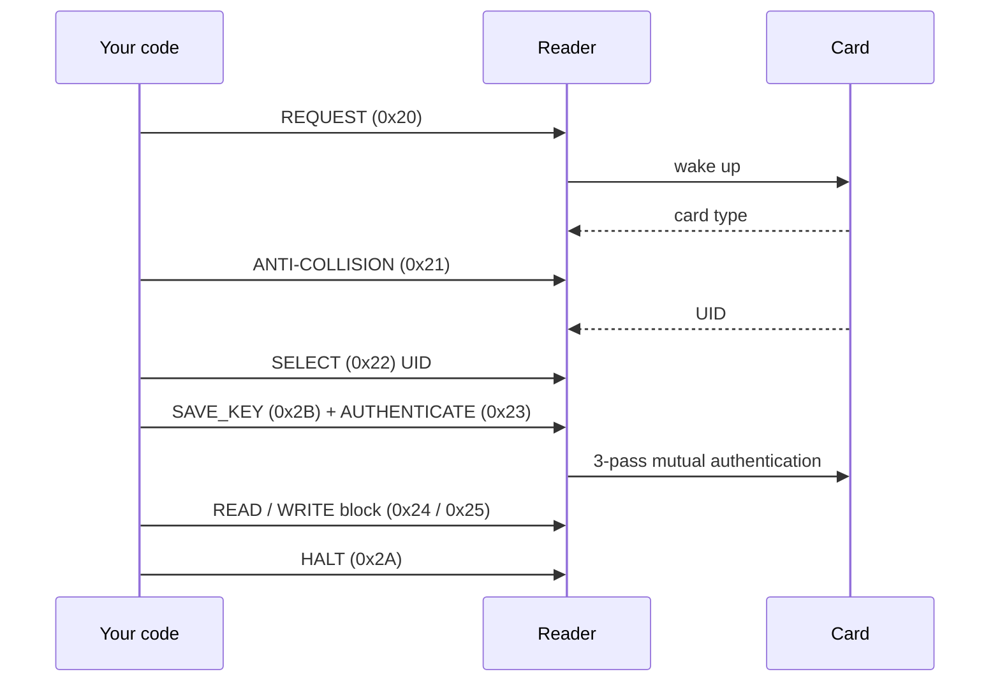

# MIFARE Classic primer

This page explains what you need to know about MIFARE® Classic cards to use
mifarepy well: how memory is organised, how keys and access conditions work,
and how value blocks store numbers.

## Memory layout

A MIFARE Classic card is divided into **sectors**. Each sector holds
**blocks** of 16 bytes, and the last block of every sector is its
**sector trailer**, which holds that sector's keys and access conditions.

=== "Classic 1K"

    16 sectors × 4 blocks × 16 bytes = **1024 bytes** (752 usable for data).

    | Sector | Absolute blocks | Contents |
    |---|---|---|
    | 0 | 0, 1, 2, 3 | Block 0 = manufacturer block (UID, read-only) · 1–2 data · 3 trailer |
    | 1 | 4, 5, 6, 7 | 4–6 data · 7 trailer |
    | … | … | … |
    | 15 | 60, 61, 62, 63 | 60–62 data · 63 trailer |

=== "Classic 4K"

    40 sectors, **4096 bytes**. Sectors 0–31 have 4 blocks each (like 1K).
    Sectors 32–39 have **16 blocks** each: 15 data blocks and a trailer.

    | Sector | Absolute blocks | Trailer |
    |---|---|---|
    | 0 – 31 | `4 × sector` … `4 × sector + 3` | last block of the sector |
    | 32 – 39 | `128 + 16 × (sector − 32)` … `+ 15` | last block of the sector |

!!! info "Relative block numbers in mifarepy"
    `read_block()` and `write_block()` take the block number **relative to the
    authenticated sector**: 0–3 in a 4-block sector, 0–15 in a large 4K sector.
    `read_sector()` and `write_sector()` cover the sector's data blocks (0–2,
    or 0–14 for sectors 32–39) and **never touch the trailer**.

The `mifarepy.layout` module does the arithmetic for you:

```python
from mifarepy import layout

layout.blocks_in_sector(35)    # 16
layout.data_blocks(35)         # range(0, 15)
layout.absolute_block(35, 0)   # 176
layout.sector_of(176)          # (35, 0)
```

!!! warning "4K large sectors"
    Large-sector support follows the card's memory map. It has been tested
    with a simulated reader only, so try it on a spare 4K card first.

### Block 0: the manufacturer block

Block 0 of sector 0 holds the UID, a check byte and manufacturer data. On
genuine cards it is written at the factory and is read-only. Do not rely on
writing it.

## The sector trailer

```text
 Byte:  0  1  2  3  4  5 | 6  7  8 | 9  | 10 11 12 13 14 15
        ---- Key A ----- | access  | GPB | ----- Key B -----
                         |  bits   |     |
```

- **Key A** (6 bytes) can never be read back. The reader returns zeros.
- **Access bits** (3 bytes) define who may read and write each block of the
  sector, and the trailer itself. They are stored together with their inverse,
  so an invalid pattern is detected, and an invalid pattern locks the sector.
- **GPB** (byte 9) is a general-purpose byte, used by the MIFARE Application
  Directory.
- **Key B** (6 bytes) is a second key, or 6 bytes of data if the access bits
  make it readable.

Fresh cards ship in the **transport configuration**:

```text
FF FF FF FF FF FF  FF 07 80  69  FF FF FF FF FF FF
     Key A          access   GPB      Key B
```

The default key is `FFFFFFFFFFFF`, and with these access bits Key A can read
and write everything.

!!! danger "Writing a trailer can lock a sector forever"
    A wrong key or a malformed access-bit pattern written to a trailer can make
    the sector unreadable and unwritable for good. mifarepy's sector helpers
    refuse to write trailers. Write one only on purpose, with
    `write_block(3, ...)`, and test on a spare card first.

## Keys and authentication

Every read or write first needs **authentication** to the sector with either
Key A or Key B:

```python
reader.authenticate_sector(sector=1, key=bytes.fromhex('FFFFFFFFFFFF'), key_type='A')
```

After that you may access any block of that sector that the access
conditions allow for that key. Authenticating to another sector replaces the
current session.



`authenticate_sector()` performs the select, key load and authentication steps
for you. `scan_tag()` performs request, anti-collision and select.

## Access conditions

Each block has three access bits **C1 C2 C3**. These are the standard
meanings defined by NXP for MIFARE Classic.

### Data blocks

| C1 C2 C3 | Read | Write | Increment | Decrement / transfer / restore | Typical use |
|---|---|---|---|---|---|
| `0 0 0` | A or B | A or B | A or B | A or B | Transport configuration |
| `0 1 0` | A or B | never | never | never | Read-only data |
| `1 0 0` | A or B | B | never | never | Read/write data |
| `1 1 0` | A or B | B | B | A or B | Value block (top-up with B) |
| `0 0 1` | A or B | never | never | A or B | Value block (decrement only) |
| `0 1 1` | B | B | never | never | Data, B only |
| `1 0 1` | B | never | never | never | Read-only, B only |
| `1 1 1` | never | never | never | never | Locked |

### Sector trailer

| C1 C2 C3 | Key A write | Access bits read / write | Key B read / write |
|---|---|---|---|
| `0 0 0` | A | A / never | A / A |
| `0 1 0` | never | A / never | A / never |
| `1 0 0` | B | A or B / never | never / B |
| `1 1 0` | never | A or B / never | never / never |
| `0 0 1` | A | A / A | A / A — transport configuration |
| `0 1 1` | B | A or B / B | never / B |
| `1 0 1` | never | A or B / B | never / never |
| `1 1 1` | never | A or B / never | never / never |

Key A is never readable. When Key B is readable (rows `000`, `010`, `001`), it
cannot be used for authentication, and those bytes act as plain data.

## Value blocks

A value block stores a **signed 32-bit integer** in a redundant 16-byte
format that the card can check:

```text
 Bytes 0-3   4-7    8-11   12   13    14   15
       value ~value value  adr  ~adr  adr  ~adr
```

The value is little-endian and stored three times (once inverted). The last
four bytes hold a block address used by backup schemes.

```python
reader.create_value_block(block=1, initial_value=100)
reader.increment_value(block=1, delta=25)    # -> 125
reader.decrement_value(block=1, delta=40)    # ->  85
print(reader.read_value(block=1))
```

!!! note "How mifarepy changes values"
    `increment_value()` and `decrement_value()` use the card's own increment
    and decrement operations, so they also work on blocks whose access
    conditions allow decrementing but not writing (access bits `0 0 1`).
    `transfer()` and `restore()` use the card's restore/transfer buffer.
    Every operation is checked by reading the block back. For money-like
    balances, also keep a backup copy in a second block and the authoritative
    balance on your server.

## Security notes

MIFARE Classic uses NXP's proprietary Crypto1 cipher, which has been publicly
broken since 2008. Keys can be recovered from a card with widely available
tools. Use Classic for convenience applications such as attendance, library
cards or loyalty points, and treat card data as **untrusted input**:

- Never use the default key `FFFFFFFFFFFF` in production. Set your own keys,
  and preferably derive a different key per card (for example from the UID
  and a secret held only by your server).
- Do not treat the UID alone as proof of identity. UIDs can be cloned.
- Keep authoritative balances and permissions on your server, and use the card
  as a pointer or cache.
- For new high-security deployments, consider **MIFARE Plus** (which can run
  in a Classic-compatible mode during a migration) or **MIFARE DESFire**.
